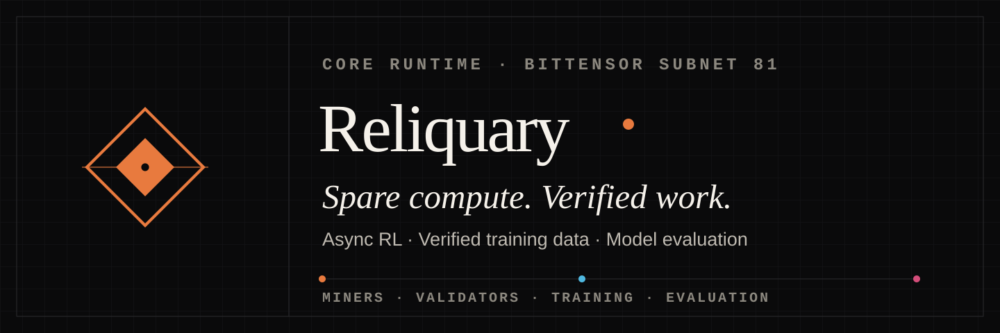

<p align="center">
  <a href="https://www.reliqua.ai">
    
  </a>
</p>

<p align="center">
  <strong>Verified frontier search for decentralized language-model training.</strong><br />
  Sixteen trajectories per prompt. Validator-authoritative rewards. Public evidence at every boundary.
</p>

<p align="center">
  <a href="https://github.com/reliquadotai/reliquary/actions/workflows/validator-tests.yml">
    
  </a>
  <a href="https://github.com/reliquadotai/reliquary/actions/workflows/cross-box-determinism.yml">
    
  </a>
  <a href="https://github.com/reliquadotai/reliquary/actions/workflows/docker-image.yml">
    
  </a>
  <a href="LICENSE.md">
    
  </a>
</p>

<p align="center">
  <a href="https://www.reliqua.ai/dashboard">Live dashboard</a>
  ·
  <a href="https://www.reliqua.ai/research">Research</a>
  ·
  <a href="https://huggingface.co/Qwen/Qwen3-4B-Base">Base model</a>
  ·
  <a href="https://github.com/orgs/reliquadotai/packages/container/package/reliquary-validator">Container</a>
  ·
  <a href="docs/mining-orders.md">Mine</a>
  ·
  <a href="docs/validating.md">Validate</a>
</p>

---

Reliquary is the open protocol and reference implementation for decentralized
GRPO training on Bittensor subnet 81. Independent miners spend their own GPU
compute searching for prompts at the policy's learning frontier. The trainer
admits, ranks, verifies, rewards, and—when the safety gates permit—trains on the
best groups.

The key incentive shift is simple: miners are not paid for producing the most
rollouts. They compete to contribute verified rollout groups the trainer can
use.

## Mining

Miners today generate customers' **Batch and Evals orders**, priced by auction and paid per verified token:
see **[Mining orders](docs/mining-orders.md)**. One address: `https://api.reliqua.ai`.

The V1 RL run ended on 2026-11-02; its miner instructions are kept in [mining.md](docs/mining.md) for reference.

## Feature status

Runtime availability is reported by `/readyz`; this table is not a GO notice.

| Layer | State |
| --- | --- |
| V1 profile: fill-closed windows with Math, Code and Logic | Configuration above; follow operator notices and runtime readiness |
| Qwen3-4B Base DAPO reasoning-v5 profile, deferred-proof auction, and GRAIL verification | **Release candidate — runtime gates pending** |
| Mixed OpenMath + OpenCode collection and validator-authoritative rewards | **Live** |
| Canonical prompt-content identity and one-shot cooldown | **Live** |
| Utility telemetry | **Live, observation only** |
| Behavior descriptors and a novelty archive | **Not deployed** |
| Novelty-shaped ranking, rewards, or training loss | **0% influence** |

The observation-only utility foundation does not alter admission, ranking,
selection, payout, or training. Its activation gates are documented in
[Auction v3 Utility Foundation](docs/auction-v3-utility-foundation.md).
Change the v5 row to **Live** only at the coordinated runtime activation. See
the [reasoning-prompt v5 cutover](docs/reasoning-prompt-v5-cutover.md) for the
fresh-baseline and deployment gates.

## Trust and verification boundaries

Reliquary is auditable, but it is not currently trustless:

- The production trainer owns checkpoint publication and is authoritative for
  reward computation, selection, quarantine, and optimizer execution.
- GRAIL sketches, signed submissions, and validator recomputation provide
  evidence that selected rollouts match their announced checkpoint. They do
  not prove that the optimizer or the validator's policy is correct.
- A signed checkpoint manifest binds a checkpoint number to an immutable
  Hugging Face revision. It is an authenticated announcement, not a proof of
  every training transition.
- Weight-only validators replay the public archive into the scoring signal.
  Multi-trainer checkpoint consensus is not implemented.

These boundaries are intentional and explicit while the network bootstraps.
The dashboard, model revisions, window archives, and security reports expose
the evidence needed to evaluate them.

## Local development

The following matches the CPU environment used by the validator test workflow:

```bash
git clone https://github.com/reliquadotai/reliquary.git
cd reliquary

python3.12 -m venv .venv
source .venv/bin/activate
python -m pip install --upgrade pip
python -m pip install torch==2.7.0 \
  --index-url https://download.pytorch.org/whl/cpu
python -m pip install -e ".[dev]"

pytest -q \
  --ignore=tests/gpu \
  --ignore=tests/integration/test_grader_e2e.py \
  --disable-warnings
```

Mining and training require the pinned inference stack and suitable NVIDIA
hardware; the CPU setup above is for development and tests. Start with the
[miner guide](docs/mining.md) or [validator guide](docs/validating.md) before
running an operator workload.

## Documentation

| Guide | Purpose |
| --- | --- |
| [Concepts](docs/concepts.md) | Current mechanism, incentives, verification, and economics |
| [Mining orders](docs/mining-orders.md) | Batch and Evals orders: the command, the order list, the price auction |
| [Mining](docs/mining.md) | Reference miner, submission lifecycle, hardware, and troubleshooting |
| [Validating](docs/validating.md) | Weight-only and trainer deployment |
| [Validator observability](docs/validator_observability.md) | Health, verdict, archive, and runtime evidence |
| [Utility foundation](docs/auction-v3-utility-foundation.md) | Observation-only research surface and activation gates |

Project-wide policies:
[Contributing](https://github.com/reliquadotai/.github/blob/main/CONTRIBUTING.md)
· [Security](https://github.com/reliquadotai/.github/blob/main/SECURITY.md)
· [Support](https://github.com/reliquadotai/.github/blob/main/SUPPORT.md)

## License

Reliquary is available under the [MIT License](LICENSE.md).
