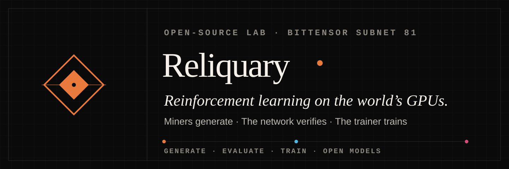

<p align="center">
  <a href="https://www.reliqua.ai">
    
  </a>
</p>

<h1 align="center">Reinforcement learning on the world's GPUs.</h1>

<p align="center">
  <strong>Generate, evaluate and train open models on a network nobody owns.</strong><br />
  An open-source lab on Bittensor subnet 81.
</p>

<p align="center">
  <a href="https://github.com/reliquadotai/reliquary/actions/workflows/validator-tests.yml">
    
  </a>
  <a href="https://github.com/reliquadotai/reliquary/actions/workflows/cross-box-determinism.yml">
    
  </a>
  <a href="https://github.com/reliquadotai/reliquary/actions/workflows/docker-image.yml">
    
  </a>
  <a href="LICENSE.md">
    
  </a>
</p>

<p align="center">
  <a href="https://www.reliqua.ai">Get access</a>
  ·
  <a href="https://www.reliqua.ai/research">Research</a>
  ·
  <a href="https://huggingface.co/ReliquaryForge">Models</a>
  ·
  <a href="docs/mining-orders.md">Mine</a>
</p>

---

## Use it

Send a JSONL file in the OpenAI Batch format, pick an open model at an exact
revision, and get back completions verified against that model.

| | What you get | Status |
| --- | --- | --- |
| **Batch generation** | Training data from a pinned model on your prompts | Early access |
| **Evaluations** | Your model graded on your tasks or a held-out benchmark, every answer inspectable | Early access |
| **RL training** | Your model trained on your own tasks and graders | Waitlist |

[Request access →](https://www.reliqua.ai)

## The most efficient way to run RL

Our goal is to be the most efficient platform for reinforcement learning, and
that starts with the rollouts. They take most of the compute: the model tries each
task again and again, and every attempt is graded. That work splits into
millions of independent pieces, so it doesn't need a datacenter. Reliquary sends
it to GPUs all over the world, from gaming cards to idle cluster capacity. Miners
compete on price, and only work that checks out gets paid.

**It already trains real models.** The trainer generated zero rollouts. Miners did
all of it.

| Model | Made by the network | Result |
| --- | --- | --- |
| [**Teutonic-I-Reliquary**](https://www.reliqua.ai/research/teutonic-i-reliquary) · 9B | ~4.5 B SFT tokens, all RL rollouts, all evaluation samples | **43.6 %** SWE-bench Verified, vs **35.1 %** for Qwen3.5-9B |
| [**Reliquary-4B**](https://www.reliqua.ai/research) · RL only, from Qwen3-4B-Base | 6.6 M RL rollouts | MATH-500 **37.2 → 72.6**, AMC23 **15.6 → 47.5** |

Teutonic-I-Reliquary trained for 11 days on rollouts from more than 11 GPU models
across seven environments. Miners kept generating while the trainer published a
new checkpoint after every step. Every GPU that joins adds capacity; the trainer
stays the same size.

## Research paper

[Gumbel Substitution: Removing Sampler Drift from RL Without Trusting the Sampler](https://arxiv.org/abs/2611.27375)  
arXiv:2611.27375 [cs.LG], submitted November 20, 2026. Preprint.

[Paper](https://arxiv.org/abs/2611.27375) · [PDF](https://arxiv.org/pdf/2611.27375) · [BibTeX](https://arxiv.org/bibtex/2611.27375) · [Model weights and model card](https://huggingface.co/ReliquaryForge/Teutonic-I-Reliquary)

## How it works

- **Miners generate.** Any NVIDIA GPU runs the current checkpoint, at its own pace.
- **The network verifies.** Each sample is checked against the published
  checkpoint, with a tolerance for differences between GPUs. Faked or substituted
  work earns nothing and never reaches training.
- **The trainer only trains.** Groups where some attempts succeed and others fail
  carry the learning signal. They go to the trainer, and each new checkpoint goes
  straight back to the network.

## Bring a GPU

Set your price per million verified tokens. The cheapest offers get work first.

```sh
reliquary corpus mine --validator-url https://api.reliqua.ai \
  --wallet-name YOUR_WALLET --hotkey YOUR_HOTKEY \
  --ask-alpha-per-mtoken 0.4 --ask-capacity 8
```

Full guide: [Mining orders](docs/mining-orders.md).

## In the open

Generation is decentralized today; the validator, the graders and the trainer are
still run by us. Verification shows that a sample came from the published
checkpoint, not that a grader or the trainer is correct. Each model result comes
from one run, published with its weights, setup and limits.

## Local development

```bash
git clone https://github.com/reliquadotai/reliquary.git && cd reliquary
python3.12 -m venv .venv && source .venv/bin/activate
python -m pip install torch==2.7.0 --index-url https://download.pytorch.org/whl/cpu
python -m pip install -e ".[dev]"
pytest -q --ignore=tests/gpu --ignore=tests/integration/test_grader_e2e.py
```

| Guide | Purpose |
| --- | --- |
| [Test a verifiable reward before RL](docs/reward-check-tutorial.md) | Run an offline reward checker and inspect reward contrast |
| [Mining orders](docs/mining-orders.md) | The command, the order list, pricing |
| [Orders](docs/orders.md) | How batch and evaluation orders are built, audited and delivered |
| [Validating](docs/validating.md) | Running a validator |

[MIT License](LICENSE.md) ·
[Contributing, security and support](https://github.com/reliquadotai/.github)
