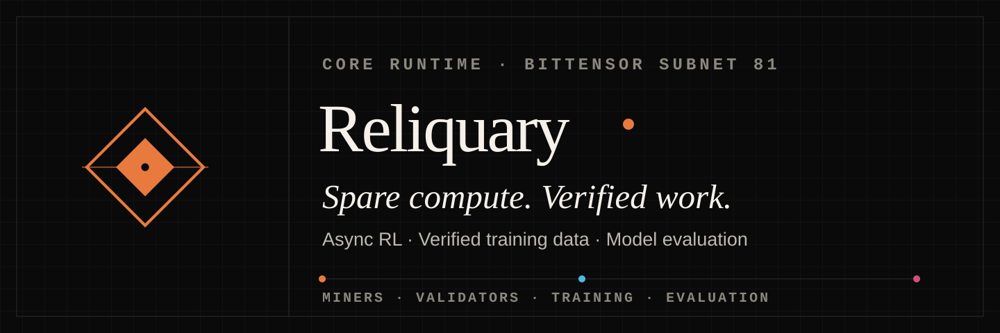
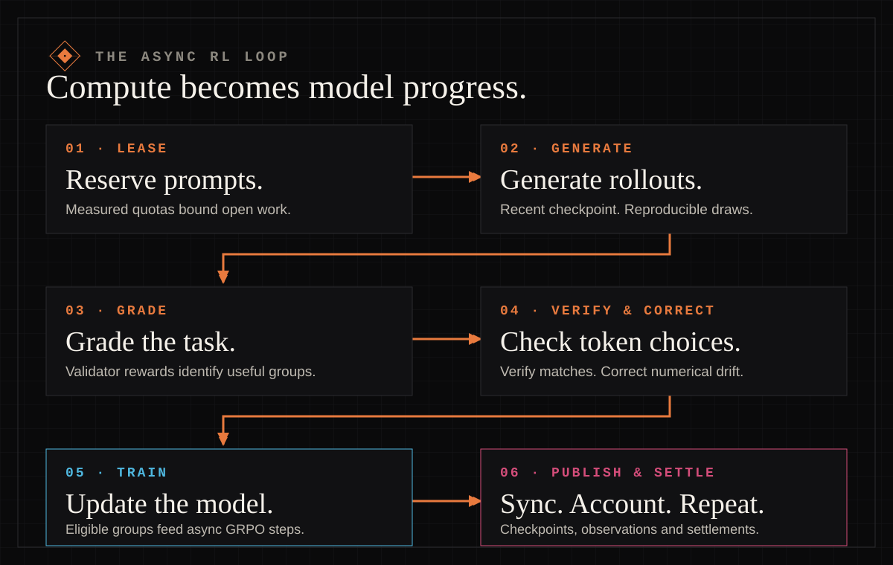

<p align="center">
  <a href="https://www.reliqua.ai/">
    
  </a>
</p>

<p align="center">
  <strong>Permissionless post-training on a distributed GPU network.</strong><br />
  Asynchronous reinforcement learning · Verified SFT data generation · Model evaluation
</p>

<p align="center">
  <a href="https://github.com/reliquadotai/reliquary/actions/workflows/validator-tests.yml">
    
  </a>
  <a href="https://github.com/reliquadotai/reliquary/actions/workflows/cross-box-determinism.yml">
    
  </a>
  <a href="https://github.com/reliquadotai/reliquary/actions/workflows/docker-image.yml">
    
  </a>
  <a href="LICENSE.md">
    
  </a>
</p>

<p align="center">
  <a href="https://www.reliqua.ai/">Website</a>
  · <a href="https://app.reliqua.ai/monitoring/run">Training dashboard</a>
  · <a href="https://app.reliqua.ai/monitoring/miner">RL miner dashboard</a>
  · <a href="https://app.reliqua.ai/docs">Mining documentation</a>
  · <a href="https://www.reliqua.ai/research">Research</a>
</p>

---

Reliquary is the open protocol and reference implementation for decentralized
AI post-training on **Bittensor Subnet 81**. Independent miners contribute GPU
compute to generate training data, produce RL rollouts and run evaluations.
Validators check the work against the declared model and task; verified
contributions feed training and the subnet's reward accounting.

The Teutonic post-training workflow combines verified miner-generated SFT data
with subsequent RL. Each run binds its own model, environments and checkpoint
lineage.

The network can use spare GPU capacity wherever it is available. In async RL,
miners work at their own pace and synchronize checkpoints in the background;
fast machines do not wait for a fleet-wide generation round. A machine can
join or leave between completed jobs, while prompt leases bound the work it
has already committed to deliver.

## Workloads

| Workload | What miners do | Verification and result |
| --- | --- | --- |
| **Asynchronous RL** | Lease prompts, generate rollout groups from a recent checkpoint, and submit single-turn answers or multi-turn tool episodes. | Validator-authoritative rewards; token verification and correction before the GRPO update; checkpoint publication and matched-token reward accounting. |
| **SFT data generation** (`corpus-generation`) | Generate completions or agentic trajectories from a job's frozen model and prompt source. | Contract-bound TOPLOC proofs and audit policy; verified tokens are settled and delivered as a dataset for training. This is data generation, not an optimizer running on every miner. |
| **Model evaluation** | Produce samples for a frozen evaluation set and model under the job's sampling contract. | Evaluation jobs audit every completion, enforce their declared draw, and grade results for comparable reports and benchmark feeds. |

These are supported code paths, not a promise that every workload or environment
is accepting work at a given moment. The task registry, published contracts and
validator responses determine what is active, its model, limits and emission cap.
The repo is not tied to the former Qwen3-4B migration or one historical run.

RL runs can combine mathematics, competitive code and instruction following
with sandboxed agent tasks such as software repair and terminal work. The
enabled environment IDs and their budgets come from the run's contract.

## How asynchronous RL works

<p align="center">
  
</p>

1. **Lease work.** A registered miner reserves prompts within its measured
   quota. Leases have deadlines; requesting more than the machine can return
   reduces useful throughput and can reduce its quota. Explicitly forfeiting
   a lease is not a free way to reroll a prompt.
2. **Generate.** The miner uses the run's checkpoint and reproducible forced
   Gumbel sampling. The reference async miner generates 16 rollouts per lease.
   Episode environments additionally bind the tool harness and sandbox contract.
3. **Grade and route.** The validator recomputes rewards. Groups with a useful
   learning signal enter the training buffer; out-of-zone first scans follow
   a separate audit and payment policy. An accepted upload is not a final
   training or payment verdict.
4. **Verify and correct.** The trainer checks the submitted token choices
   against its own forward pass. Match thresholds gate participation;
   token substitution corrects numerical differences before training.
   Termination and reward changes are also checked. This is the async RL
   verification path, distinct from corpus TOPLOC proofs and legacy GRAIL.
5. **Train asynchronously.** The detached trainer builds a batch from eligible
   groups, performs the GRPO update and reports verification outcomes.
   Checkpoint-lag limits keep excessively stale work out of training.
6. **Publish and settle.** Signed checkpoint indexes expose hashed anchors and
   deltas through short-lived R2 download URLs. Miners sync the next weights;
   the ledger accrues eligible work and publishes period settlements for the
   subnet's weight calculation.

The goal is to let heterogeneous GPUs contribute without letting differences
in their inference numerics destabilize training. Permissionless participation
still requires enough memory for the model and context, a compatible runtime,
and compliance with the run's verification rules.

### Rewards

Async RL pays eligible trained rollouts by **matched tokens**, at the
environment's token price, rather than by a miner's claimed GPU model or raw
submission count. First scans outside the learning zone have their own reduced
reward rule. Task caps, audit outcomes, bans and settlement rules constrain the
final emission share; an accrual is not a guaranteed on-chain payout.

Corpus jobs account for verified tokens under their own audit and settlement
policy. Use the task's published cap and the miner's settled share to interpret
rewards. Neither token accounting nor a declared GPU count is a GPU-rental price
or a guaranteed dollar return.

## Start mining

Start with the [mining documentation](https://app.reliqua.ai/docs) and the
operator's current task announcement. Use the runtime or image qualified for
that task's contract: the CPU development setup below is not a GPU installation
recipe, and a historical container tag is not a current compatibility guarantee.
Keep the miner's work directory persistent across restarts.

### Async RL miner

The following is a command template for an installed, compatible runtime. Set
`RL_ENVIRONMENTS` to a comma-separated subset of the run's advertised environment
IDs, and set `VALIDATOR_URL` and `VALIDATOR_HOTKEY` from its operator announcement.
The validator hotkey is its **public SS58 address**; the miner hotkey below is
the name of your existing identity registered on SN81.

```bash
reliquary mine-async \
  --validator-url "$VALIDATOR_URL" \
  --validator-hotkey "$VALIDATOR_HOTKEY" \
  --wallet-name YOUR_WALLET \
  --hotkey YOUR_REGISTERED_HOTKEY \
  --environments "$RL_ENVIRONMENTS" \
  --work-dir ./rl-async-work
```

Omit **both** validator options to discover the validator through the metagraph.
With an explicit URL, its public hotkey is required to bind signed requests to
the intended validator. The miner syncs the published checkpoint anchors and
deltas; do not reuse a model revision or protocol profile from an older run.

`reliquary mine-async --help` lists generation batching, lease and queue limits,
context length, memory utilization, quantization and episode-engine options.
Choose settings that fit the card **and** pass the run's verification rules;
quantization support alone does not establish eligibility. For episode tasks,
also install the exact advertised environment/harness dependencies.

`--share-setup` optionally reports hardware information for observability.
These are **declared GPU specifications**, not hardware attestation, and are
never used as proof of useful work or as a direct scoring input.

### Corpus and evaluation miner

Select a job served by the corpus validator; each process mines one job:

```bash
reliquary corpus mine \
  --validator-url "$CORPUS_VALIDATOR_URL" \
  --job-id "$JOB_ID" \
  --wallet-name YOUR_WALLET \
  --hotkey YOUR_REGISTERED_HOTKEY
```

The miner reads the served job and contract, checks the checkpoint fingerprint
and generates its TOPLOC proofs. Agentic corpus jobs use
`reliquary corpus mine-agentic`; check its help for the required validator and
harness options. Read one public hotkey's job status without loading a wallet:

```bash
reliquary corpus status \
  --validator-url "$CORPUS_VALIDATOR_URL" \
  --job-id "$JOB_ID" \
  --hotkey "$MINER_SS58_ADDRESS"
```

This reports audit state, accepted/pending/passed/failed submissions, recent
audit failures and available settlement information.

## Validators, training and environments

- **Controller:** owns the declared task, prompt leases, admission, grading,
  submission state, reward ledger and public RL routes. Async mode is selected
  with `RELIQUARY_RL_MODE=async` and requires a task declared with
  `reliquary tasks create --rl-async`.
- **Detached trainer:** `reliquary train-async` consumes the controller's buffer,
  verifies tokens, runs optimizer steps and publishes checkpoints. Its
  authenticated trainer listener is separate from the public mining API and
  belongs on loopback or a private network. See the
  [trainer command](reliquary/cli/main.py) for its environment variables.
- **Weight-only validators:** read task settlement archives, compute the
  scoring signal and submit subnet weights without running the optimizer.
- **Environment packages:** define task generation, tool interaction and
  authoritative grading. New environment source lives in
  [reliquary-environments](https://github.com/reliquadotai/reliquary-environments);
  execution isolation and the shared harness live in
  [reliquary-sandbox](https://github.com/reliquadotai/reliquary-sandbox).
  Installing an environment does not activate it: the run must declare its
  pinned identity and pass the relevant qualification gates.

Deployment requires the run's task declaration, compatible model/runtime,
storage, sandbox and signing configuration. Use the operator runbooks and
qualified release before starting a production workload.

## Follow the work

The [training dashboard](https://app.reliqua.ai/monitoring/run) presents run
progress, benchmark results, training health and declared GPU participation.
The [RL miner dashboard](https://app.reliqua.ai/monitoring/miner) exposes
available hotkey-level performance and diagnostics.

The async validator provides these read-only surfaces:

| Route | Purpose |
| --- | --- |
| `GET /rl/checkpoint` | Signed checkpoint index and expiring anchor/delta download URLs. |
| `GET /rl/quota?hotkey=<SS58>` | The miner's quota and its explanation. |
| `GET /rl/pay?hotkey=<SS58>` | Environment prices and the hotkey's ledger state. |
| `GET /rl/prompts/state` | Prompt lifecycle, scans and cooldown state. |
| `GET /rl/observations` | Signed observation segments for network monitoring. |
| `GET /rl/benchmarks?run_id=<RUN_ID>` | Published benchmark feed for that native run; unavailable until a feed exists. |
| `GET /rl/episodes` | Advertised episode contracts, when the run includes episode environments. |

The optional `GET /rl/miner-submissions?run_id=<RUN_ID>` journal is disabled by
default and requires an operator-qualified export boundary. When enabled it
returns a bounded recent history, not every historical request. See
[submission journal configuration](docs/rl-async-qualification.md#optional-miner-submission-journal).

### Trust boundaries

Reliquary publishes evidence, but is **not fully trustless**. The controller
and trainer remain authoritative for grading, token checks, optimizer execution
and checkpoint publication. Signed submissions and checkpoint indexes
authenticate identities and artifact hashes; they do not prove an optimizer
transition or an unforgeable GPU identity. There is no multi-trainer checkpoint
consensus. Qualification measurements describe the configurations tested, not
every GPU or future run.

## Local development

The following matches the Linux CPU baseline in
[validator CI](.github/workflows/validator-tests.yml):

```bash
git clone https://github.com/reliquadotai/reliquary.git
cd reliquary
python3.12 -m venv .venv
source .venv/bin/activate
python -m pip install --upgrade pip
python -m pip install torch==2.7.0 \
  --index-url https://download.pytorch.org/whl/cpu
python -m pip install -e ".[dev]"

pytest -q \
  --ignore=tests/gpu \
  --ignore=tests/integration/test_grader_e2e.py \
  --ignore=tests/unit/test_corpus_split_e2e.py
```

CI runs the corpus split end-to-end tests separately and shards the remaining
CPU suite. GPU generation/training, model qualification and sandbox integration
need their own compatible hardware and runtime; passing CPU tests does not
qualify a production deployment.

## Documentation and implementation

| Reference | Scope |
| --- | --- |
| [CLI](reliquary/cli/main.py), [async miner](reliquary/miner/rl_async.py), [controller](reliquary/validator/rl_async_service.py), [trainer](reliquary/trainer/async_trainer.py) | Current async entry points and behavior. |
| [Async RL design](docs/rl-async-design.md), [qualification record](docs/rl-async-qualification.md) | Design background and launch measurements/plans; dated values are not live configuration. |
| [Corpus task launch](docs/runbooks/corpus-task-launch.md) | Declare, qualify, serve and settle a data-generation job. |
| [Checkpoint evaluation](docs/runbooks/evaluation-on-our-validator.md) | Frozen sets, verified samples, grading and comparable reports. |
| [Task lifecycle](docs/task-lifecycle.md) | Corpus admission, pause/resume, retirement and executor recovery. |
| [Environment qualification](docs/standalone-environment-qualification.md), [episode bridge](docs/runbooks/rl-bridged-episode-envs.md) | Pinned environment integration and qualification; check which runtime a section targets. |

**Historical documentation:** [Mining](docs/mining.md),
[Concepts](docs/concepts.md) and [Validating](docs/validating.md) retain material
about fixed windows, auctions, GRAIL and older model profiles. Do not apply those
timings, selection rules or migration pins to `mine-async`. The current task
contract and runtime take precedence.

Project-wide policies:
[Contributing](https://github.com/reliquadotai/.github/blob/main/CONTRIBUTING.md)
· [Security](https://github.com/reliquadotai/.github/blob/main/SECURITY.md)
· [Support](https://github.com/reliquadotai/.github/blob/main/SUPPORT.md)

## License

Reliquary is available under the [MIT License](LICENSE.md).
